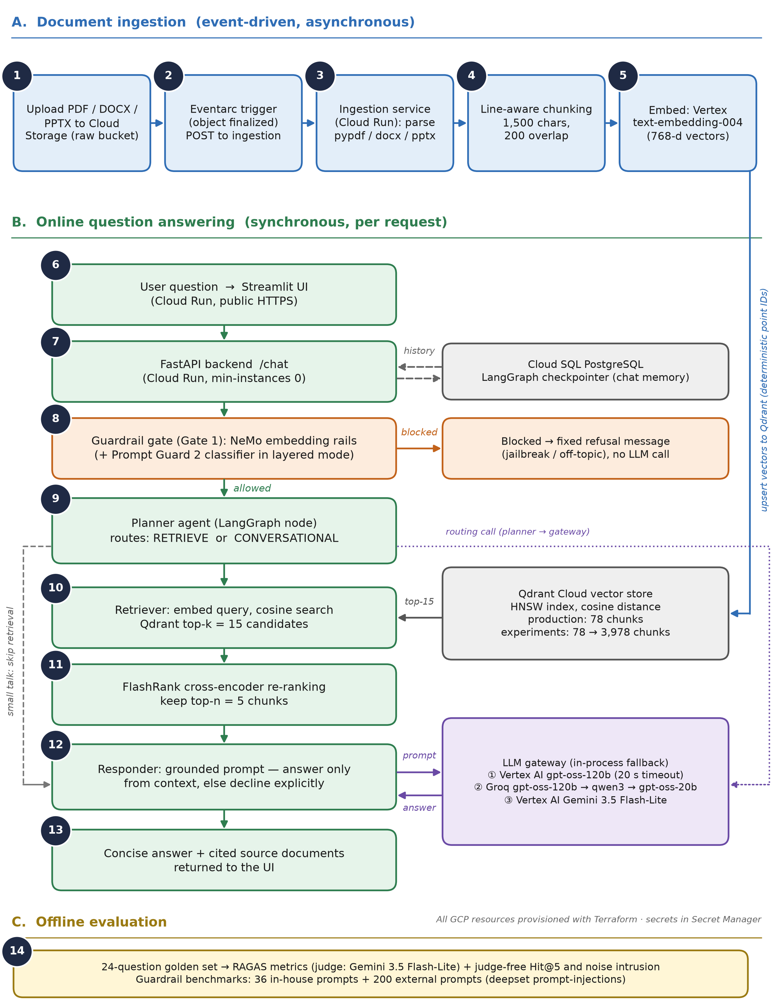
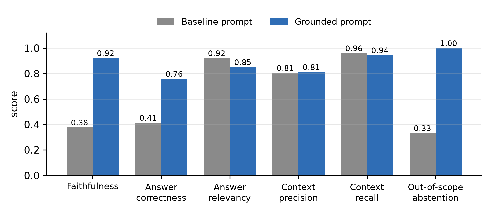
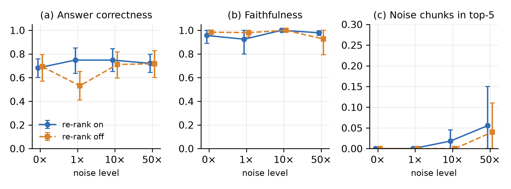
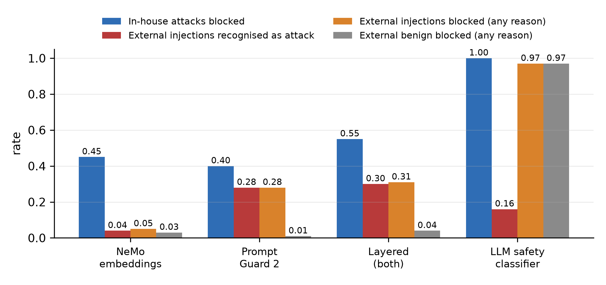

# Enterprise Agentic RAG on Google Cloud

A guardrailed, gateway-routed retrieval-augmented generation (RAG) assistant, deployed serverlessly on Google Cloud with Terraform and evaluated with RAGAS.

It answers questions about a Kubernetes documentation corpus. On every request it:

- refuses jailbreak and off-topic requests before any LLM call;
- falls back across LLM providers when one is slow or down;
- declines questions the documents don't cover;
- returns the source documents it used.

**Team:** Pratyush Rai, Yash Phoujdar, Swaraj Joshi. School of Computer Science and Engineering, VIT Vellore.

---

## Architecture



**A. Ingestion (steps 1–5), event-driven:**

1. A file uploaded to the raw Cloud Storage bucket raises an event.
2. Eventarc delivers the event to the ingestion service.
3. The service parses the file (PDF, DOCX, PPTX, HTML, TXT).
4. The text is split into line-aware chunks of 1,500 characters with 200 overlap.
5. Each chunk is embedded with Vertex AI `text-embedding-004` (768-d) and upserted into Qdrant with deterministic IDs.

**B. Question answering (steps 6–13):**

6. The user asks a question in the Streamlit UI.
7. The FastAPI backend receives it and loads chat history from Cloud SQL.
8. The **guardrail gate** blocks jailbreak and off-topic input with a fixed refusal; no LLM is called.
9. The **planner** agent routes small talk straight to the responder and rewrites everything else into a search query.
10. The **retriever** fetches the top-15 chunks from Qdrant.
11. A **FlashRank** cross-encoder keeps the best 5.
12. The **responder** answers *only* from those chunks, or says "The provided documentation does not cover this."
13. The answer and its sources are returned to the UI.

The planner and responder call models through an in-process **LLM gateway** that falls back across providers:

| Order | Deployed | Phase 4 experiments |
|---|---|---|
| 1 | Groq `gpt-oss-120b` | Vertex AI `gpt-oss-120b` |
| 2 | Groq `qwen3`, `gpt-oss-20b` | Groq `gpt-oss-120b`, `qwen3`, `gpt-oss-20b` |
| 3 | Gemini 3.5 Flash-Lite (Vertex AI) | Gemini 3.5 Flash-Lite (Vertex AI) |

**C. Evaluation (step 14):** RAGAS metrics with a Gemini judge, judge-free retrieval metrics and bootstrap 95% confidence intervals.

## Tech stack

| Layer | Technology |
|---|---|
| Agent and API | LangGraph (planner → retriever → responder), LangChain, FastAPI, Streamlit, Pydantic |
| Retrieval | Vertex AI `text-embedding-004`, Qdrant Cloud (HNSW, cosine), FlashRank cross-encoder |
| Safety | NVIDIA NeMo Guardrails (embeddings-only, Colang rules); compared against Llama Prompt Guard 2 and `gpt-oss-safeguard-20b` |
| Models | `gpt-oss-120b` on Groq / Vertex AI, Gemini 3.5 Flash-Lite as last resort |
| Google Cloud | Cloud Run (3 services, scale to zero), Cloud Storage, Eventarc, Cloud SQL PostgreSQL 15 (LangGraph checkpointer), Secret Manager, Artifact Registry, Cloud Build, per-service IAM accounts |
| Infrastructure as code | Terraform (`terraform/`) |
| Observability | Logfire spans, viewed in Cloud Logging |
| Evaluation | RAGAS 0.4, Gemini 3.5 Flash-Lite judge, bootstrap CIs |

## Results

Full analysis: [evals/analysis/phase4_report.md](evals/analysis/phase4_report.md) and [DOCS/22_EVALUATION.md](DOCS/22_EVALUATION.md). Raw runs: [evals/results/](evals/results/).

**1. Grounded responder prompt (24 questions)**

| Metric | Baseline prompt | Grounded prompt |
|---|---|---|
| Faithfulness | 0.38 | **0.92** |
| Answer correctness | 0.41 | **0.76** |
| Context precision / recall | 0.81 / 0.96 | 0.81 / 0.94 |
| Out-of-scope questions declined | 1 / 3 | **3 / 3** |

**2. Robustness to index noise (78 → 3,978 chunks, unrelated PDFs)**

| Noise | Chunks | Hit@5 | Answer correctness (95% CI), re-rank on | Noise in top-5 |
|---|---|---|---|---|
| 0× | 78 | 1.00 | 0.68 (0.60–0.76) | 0% |
| 1× | 156 | 1.00 | 0.75 (0.64–0.85) | 0% |
| 10× | 858 | 1.00 | 0.75 (0.65–0.84) | 2% |
| 50× | 3,978 | 1.00 | 0.72 (0.64–0.80) | 6% |

Re-ranking significantly improved correctness only at 1× (+0.22). Run-to-run standard deviation of correctness was about 0.07.

**3. Guardrail modes**

The in-house set has 20 attacks and 12 legitimate questions. The external set is 100 injections and 100 benign prompts from deepset prompt-injections.

| Mode | In-house attacks blocked | False blocks | External injections recognised as attack | Median latency |
|---|---|---|---|---|
| NeMo embedding rails (deployed) | 45% | 0% | 4% | 0.1 s |
| Llama Prompt Guard 2 | 40% | 0% | 28% | 0.2 s |
| Layered (rails + Prompt Guard) | 55% | 0% | 30% | 0.3 s |
| LLM classifier (`gpt-oss-safeguard-20b`) | 100% | 0% | 16% (blocks 97% as off-topic) | 21 s (free tier) |

Reliability: 0 failed questions across all runs; the gateway absorbed provider slowdowns. Live latency is about 3 s per answer.

| Prompt grounding | Noise scaling | Guardrails |
|---|---|---|
|  |  |  |

## Repository layout

```text
app/
  agents/          LangGraph graph, state, planner / retriever / responder nodes
  gateway/         LLM fallback chain (Vertex AI, Groq, Gemini)
  guardrails/      NeMo rails, Prompt Guard / safeguard modes, Colang rules
  ingestion/       loaders (pdf, office, html, text), line-aware splitter, processor
  services/        Qdrant search, Vertex embeddings, FlashRank, Cloud SQL, optional Redis cache
  config.py        all settings, read from environment variables
  main.py          FastAPI app (POST /query)
ui/app.py          Streamlit chat UI
docker/            backend, UI and ingestion images (built by cloudbuild.yaml)
terraform/         all Google Cloud resources
evals/             datasets, pipeline runner, RAGAS scoring, analysis, results
DATA/true_data/    the six Kubernetes documents that are indexed
DOCS/              design notes, deployment runbook, evaluation, demo guide
```

## Run locally

Requires Python 3.11, [uv](https://docs.astral.sh/uv/), a Groq API key, a Qdrant Cloud cluster and a GCP project with Vertex AI enabled.

1. Install the dependencies:

   ```bash
   uv venv --python 3.11 .venv
   uv pip install --python .venv/Scripts/python.exe -r requirements.txt
   ```

2. Copy `.env.example` to `.env` and fill in your keys. Keep `LOCAL_MODE=true` to use in-memory chat history instead of Cloud SQL. Log in for Vertex AI:

   ```bash
   gcloud auth application-default login
   ```

3. Index the documents:

   ```bash
   .venv/Scripts/python.exe -m app.ingestion.processor DATA/true_data --wipe
   ```

4. Start the backend and the UI, in two terminals:

   ```bash
   .venv/Scripts/python.exe -m uvicorn app.main:app --port 8000
   ```

   ```bash
   .venv/Scripts/python.exe -m streamlit run ui/app.py
   ```

## Deploy to Google Cloud

Follow [DOCS/21_DEPLOYMENT_RUNBOOK.md](DOCS/21_DEPLOYMENT_RUNBOOK.md). In short:

1. Copy `terraform/terraform.tfvars.example` to `terraform.tfvars` and fill it in.
2. Build the images with `gcloud builds submit --config cloudbuild.yaml`.
3. Run `terraform apply` in `terraform/`.

Redis (semantic cache) is written in Terraform but off by default (`enable_redis = false`) to keep idle cost near zero.

## Reproduce the evaluation

The evaluation tools run in a separate environment, because RAGAS pins different LangChain versions:

```bash
uv venv --python 3.11 .venv-evals
uv pip install --python .venv-evals/Scripts/python.exe -r requirements-evals.txt
```

How to run the pipeline, score it and analyse it, including the noise collections:

- [DOCS/22_EVALUATION.md](DOCS/22_EVALUATION.md)
- [evals/run_phase4.sh](evals/run_phase4.sh)

The noise PDFs are third-party material and aren't in the repository. Pass your own folder with `--noise-dir`.

## Documentation

| Document | Topic |
|---|---|
| [23_DEMO_GUIDE_AND_TECH_STACK](DOCS/23_DEMO_GUIDE_AND_TECH_STACK.md) | Every component explained, plus a live log walkthrough |
| [22_EVALUATION](DOCS/22_EVALUATION.md) | Metrics, datasets, how to run the evals |
| [21_DEPLOYMENT_RUNBOOK](DOCS/21_DEPLOYMENT_RUNBOOK.md) | Step-by-step GCP deployment |
| [20_INFRASTRUCTURE_AS_CODE_TERRAFORM](DOCS/20_INFRASTRUCTURE_AS_CODE_TERRAFORM.md) | Terraform layout |
| [01](DOCS/01_SYSTEM_OVERVIEW.md)–[19](DOCS/19_MICROSERVICES_AND_CONTAINERIZATION.md) | Design notes from the reference architecture (ingestion, agent nodes, tracing, IAM, Eventarc, Postgres memory, optional Redis/VPC) |
