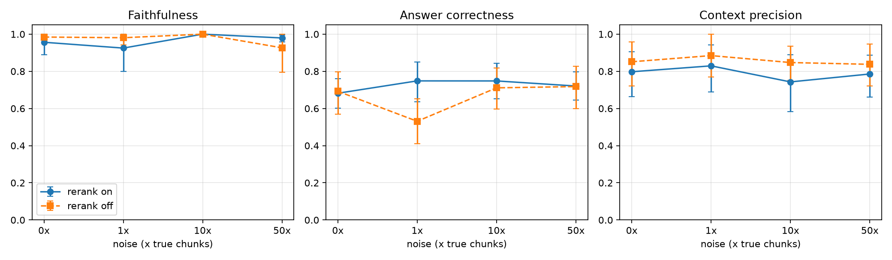
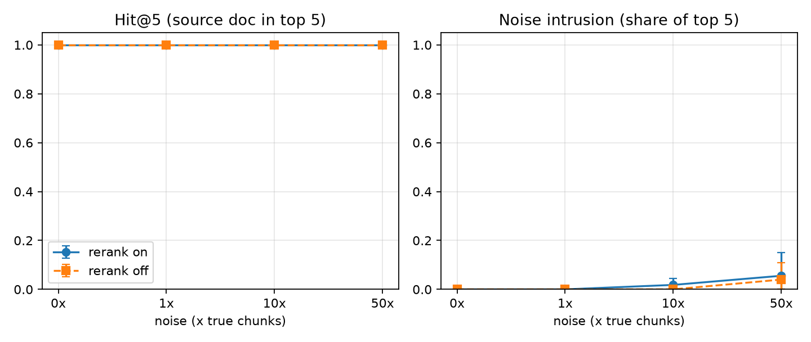
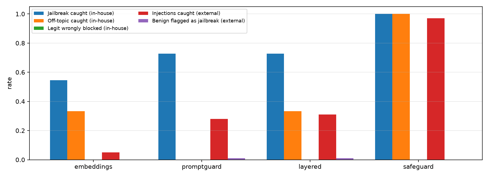

# Phase 4 results

All RAG runs: grounded prompt, primary model gpt-oss-120b (Vertex AI), guardrails off, judge gemini-3.5-flash-lite. Values: mean [95% bootstrap CI over questions]; repeats are averaged per question first. Retrieval metrics (hit@5, noise intrusion) need no judge.

## E1/E2: noise level x reranker

| Noise | Rerank | Runs | faithfulness | answer_correctness | answer_relevancy | context_precision | context_recall | hit_at_5 | noise_intrusion | abstained | latency_s |
|---|---|---|---|---|---|---|---|---|---|---|---|
| 0x | on | 3 | 0.956 [0.889, 1.000] | 0.682 [0.601, 0.760] | 0.819 [0.744, 0.876] | 0.798 [0.664, 0.906] | 0.966 [0.918, 1.000] | 1.000 [1.000, 1.000] | 0.000 [0.000, 0.000] | 0.778 [0.667, 1.000] | 28.189 [24.282, 32.423] |
| 0x | off | 1 | 0.984 [0.953, 1.000] | 0.692 [0.570, 0.796] | 0.888 [0.847, 0.928] | 0.851 [0.721, 0.958] | 1.000 [1.000, 1.000] | 1.000 [1.000, 1.000] | 0.000 [0.000, 0.000] | 1.000 [1.000, 1.000] | 26.525 [18.883, 35.552] |
| 1x | on | 1 | 0.925 [0.800, 1.000] | 0.749 [0.636, 0.851] | 0.872 [0.825, 0.911] | 0.829 [0.689, 0.943] | 0.942 [0.875, 1.000] | 1.000 [1.000, 1.000] | 0.000 [0.000, 0.000] | 0.667 [0.000, 1.000] | 27.976 [20.263, 36.862] |
| 1x | off | 1 | 0.981 [0.942, 1.000] | 0.531 [0.410, 0.652] | 0.864 [0.765, 0.936] | 0.885 [0.769, 1.000] | 1.000 [1.000, 1.000] | 1.000 [1.000, 1.000] | 0.000 [0.000, 0.000] | 1.000 [1.000, 1.000] | 29.944 [24.574, 35.401] |
| 10x | on | 1 | 1.000 [1.000, 1.000] | 0.748 [0.653, 0.844] | 0.864 [0.827, 0.902] | 0.743 [0.583, 0.890] | 0.939 [0.868, 1.000] | 1.000 [1.000, 1.000] | 0.018 [0.000, 0.045] | 1.000 [1.000, 1.000] | 28.292 [20.151, 36.883] |
| 10x | off | 1 | 1.000 [1.000, 1.000] | 0.711 [0.597, 0.819] | 0.886 [0.835, 0.929] | 0.847 [0.750, 0.935] | 1.000 [1.000, 1.000] | 1.000 [1.000, 1.000] | 0.000 [0.000, 0.000] | 0.667 [0.000, 1.000] | 25.932 [17.947, 34.839] |
| 50x | on | 3 | 0.979 [0.958, 0.996] | 0.721 [0.644, 0.797] | 0.848 [0.793, 0.894] | 0.786 [0.661, 0.887] | 0.966 [0.923, 1.000] | 1.000 [1.000, 1.000] | 0.056 [0.000, 0.150] | 0.778 [0.667, 1.000] | 29.599 [25.187, 34.534] |
| 50x | off | 1 | 0.926 [0.794, 1.000] | 0.718 [0.600, 0.827] | 0.875 [0.779, 0.943] | 0.838 [0.722, 0.946] | 0.980 [0.941, 1.000] | 1.000 [1.000, 1.000] | 0.040 [0.000, 0.110] | 1.000 [1.000, 1.000] | 27.873 [22.651, 32.823] |

## Paired effect of the reranker (on minus off, same questions)

| Noise | faithfulness | answer_correctness | context_precision | hit_at_5 | noise_intrusion |
|---|---|---|---|---|---|
| 0x | -0.042 [-0.141, 0.031] | -0.010 [-0.121, 0.104] | -0.097 [-0.231, 0.042] | 0.000 [0.000, 0.000] | 0.000 [0.000, 0.000] |
| 1x | -0.021 [-0.125, 0.062] | 0.217 [0.040, 0.377] | -0.145 [-0.329, 0.025] | 0.000 [0.000, 0.000] | 0.000 [0.000, 0.000] |
| 10x | 0.000 [0.000, 0.000] | 0.037 [-0.081, 0.149] | -0.086 [-0.292, 0.127] | 0.000 [0.000, 0.000] | 0.000 [0.000, 0.000] |
| 50x | 0.055 [-0.018, 0.180] | 0.003 [-0.082, 0.096] | -0.084 [-0.229, 0.063] | 0.000 [0.000, 0.000] | -0.008 [-0.024, 0.000] |

## Run-to-run variance (rerank on, identical config)

| Noise | Runs | faithfulness | answer_correctness | answer_relevancy | context_precision | context_recall |
|---|---|---|---|---|---|---|
| 0x | 3 | 0.950 ± 0.023 | 0.682 ± 0.073 | 0.819 ± 0.025 | 0.789 ± 0.018 | 0.962 ± 0.009 |
| 50x | 3 | 0.978 ± 0.011 | 0.721 ± 0.062 | 0.848 ± 0.036 | 0.766 ± 0.015 | 0.966 ± 0.007 |

(mean ± standard deviation of the run means)

## E3: guardrail modes

In-house set: 20 attacks (11 jailbreak, 9 off-topic), 12 legitimate, 4 small talk. External set: 100 injections + 100 general benign prompts (deepset/prompt-injections sample).

| Mode | Set | guard_recall | guard_false_block_rate | guard_acc_jailbreak | guard_acc_off_topic | guard_acc_small_talk | injection_recall | injection_recall_as_jailbreak | benign_flagged_jailbreak | benign_blocked_any | guard_latency_p50_ms | guard_errors |
|---|---|---|---|---|---|---|---|---|---|---|---|---|
| embeddings | inhouse | 0.450 | 0.000 | 0.545 | 0.333 | 0.750 |  |  |  |  | 100.000 | 0 |
| embeddings | external | 0.050 | 0.030 |  |  |  | 0.050 | 0.040 | 0.000 | 0.030 | 110.000 | 0 |
| promptguard | inhouse | 0.400 | 0.000 | 0.727 | 0.000 | 0.000 |  |  |  |  | 190.000 | 0 |
| promptguard | external | 0.280 | 0.010 |  |  |  | 0.280 | 0.280 | 0.010 | 0.010 | 2320.000 | 0 |
| layered | inhouse | 0.550 | 0.000 | 0.727 | 0.333 | 0.750 |  |  |  |  | 280.000 | 0 |
| layered | external | 0.310 | 0.040 |  |  |  | 0.310 | 0.300 | 0.010 | 0.040 | 2400.000 | 0 |
| safeguard | inhouse | 1.000 | 0.000 | 1.000 | 1.000 | 0.250 |  |  |  |  | 20690.000 | 0 |
| safeguard | external | 0.970 | 0.970 |  |  |  | 0.970 | 0.160 | 0.000 | 0.970 | 20730.000 | 0 |

## Figures

